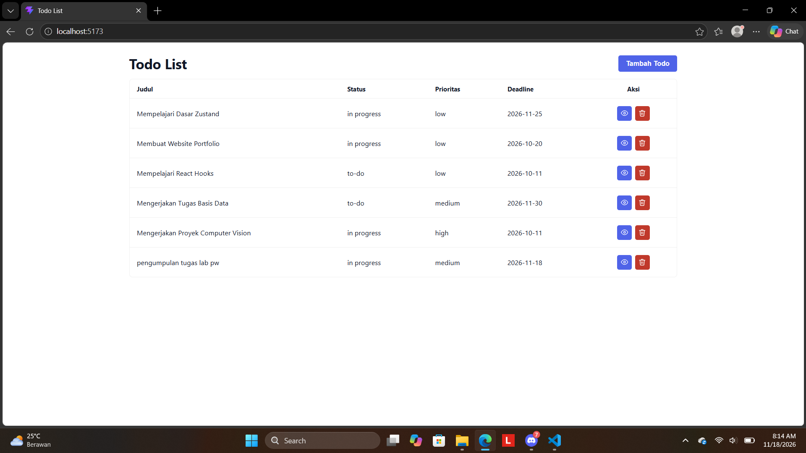
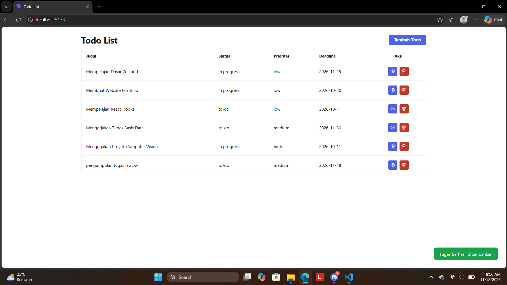
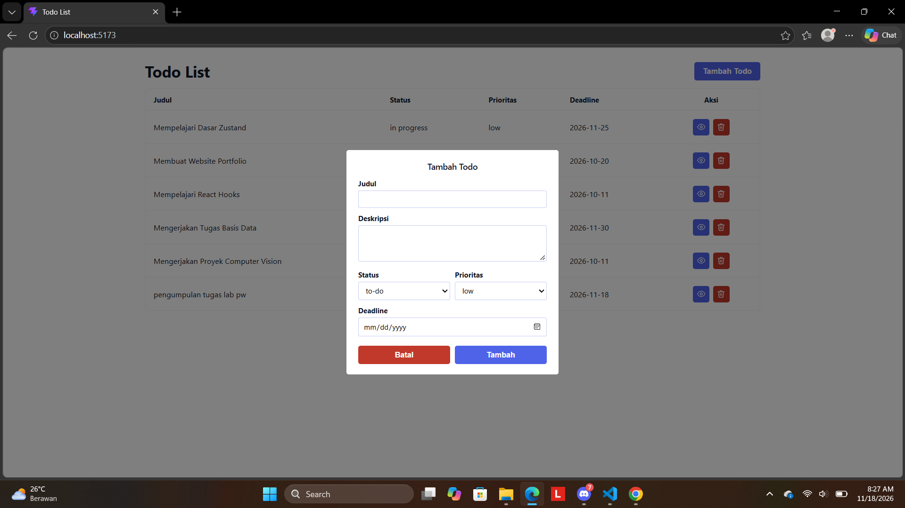
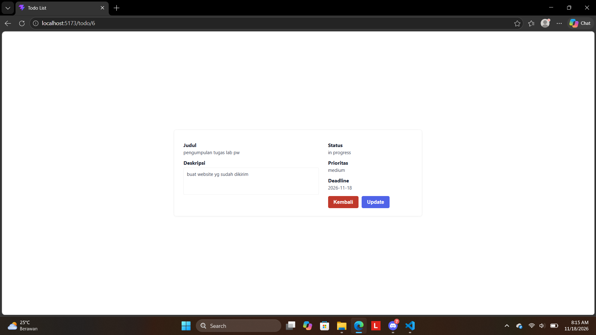
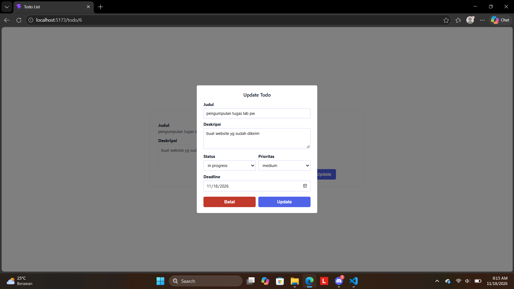
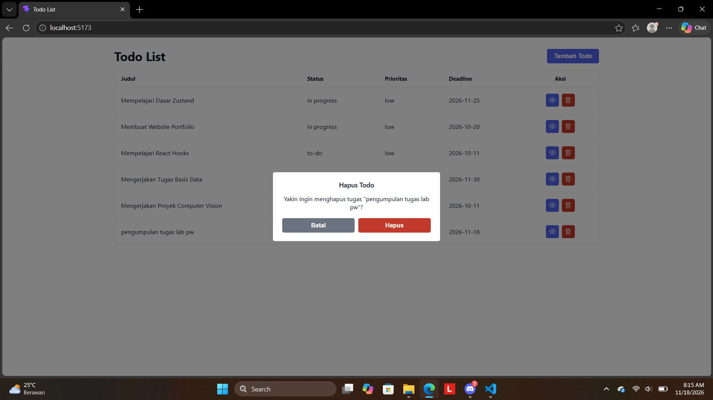

# Kuis Praktikum – To-Do List (React.js)

Aplikasi frontend To-Do List dengan React + Vite. Hanya frontend, memakai data dummy
(belum memanggil REST API).

## Cara menjalankan

```bash
npm install
npm run dev
```

Buka http://localhost:5173

## Fitur

| Fitur | Keterangan |
|---|---|
| Menampilkan tugas | Tabel Judul, Status, Prioritas, Deadline, Aksi (`/`) |
| Detail tugas | Ikon mata membuka halaman `/todo/:id` |
| Tambah tugas | Tombol "Tambah Todo" membuka modal form |
| Update tugas | Tombol "Update" di halaman detail membuka modal form |
| Hapus tugas | Ikon tempat sampah, dengan dialog konfirmasi |
| Umpan balik | Validasi form, dialog konfirmasi hapus, dan notifikasi toast |

## Struktur data

```js
{ id, title, description, priority, deadline, status }
```

Sesuai ketentuan kuis agar mudah diintegrasikan dengan endpoint `/api/todos`.

## Struktur proyek

```
src/
  context/TodoContext.jsx   # React State (useState) + fungsi CRUD
  data/dummyTodos.js        # data dummy
  pages/TodoList.jsx        # halaman daftar
  pages/TodoDetail.jsx      # halaman detail + update
  components/               # Modal, TodoForm, ConfirmDialog, Toast
```

## Screenshot

### Halaman Daftar


### Halaman Berhasil menambahkan


### Modal Tambah Todo


### Halaman Detail


### Modal Update Todo


### Konfirmasi Hapus

